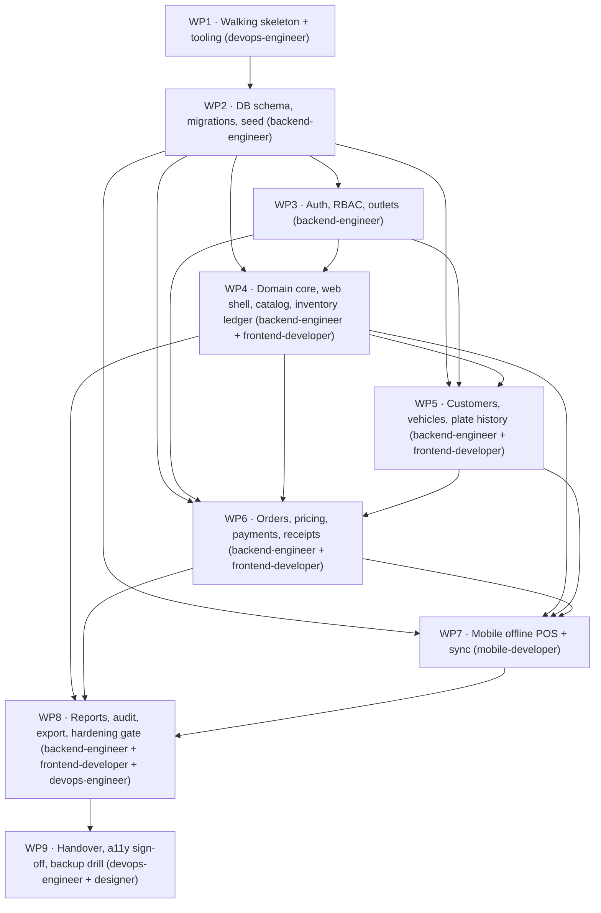

# Workshop POS — Work Packages

| | |
|---|---|
| Version | 1.0 |
| Date | 2026-11-26 |
| Status | Proposed (awaiting `decision-reviewer` acceptance) |
| Source documents | `docs/product/PRD.md` (FR/BR/NFR/PD/US IDs), `docs/adr/0001-stack-and-architecture.md` |
| Related | `docs/ops/handover-checklist.md`, `docs/ops/license-inventory.md`, `docs/ops/decision-policy.md` |
| Constraint | This is a planning document. No application code, CI pipeline, or git hook is created by it. |

**How to read this document**

- Owned paths are **exact file/directory lists, no globs**. A directory means everything beneath it. Two WPs must never own the same path while running concurrently; when a later WP legitimately revisits a file an earlier WP created (e.g., WP5 replacing WP1's skeleton page), that is sequential reuse, not concurrent ownership, and it is called out explicitly.
- PRD IDs (`FR-nnn`, `BR-nnn`, `NFR-nnn`, `PD-nnn`, `US-nn`) are quoted verbatim from the PRD; the traceability matrix in §4 proves nothing is orphaned.
- Sizing uses relative **S / M / L** only. No day or cost estimates (D-10 is a contract matter; labor pricing is out of scope).

---

## 1. Sequencing & parallelization rule

1. **WP1 is the gate.** Nothing else starts until WP1 lands a green `scripts/check.sh`, a running Postgres service, and the walking-skeleton page + health endpoint. Before that, there is no shared harness to verify anyone's work.
2. **After WP1, file-disjoint WPs may run concurrently** — subject to rule 3.
3. **Shared contracts land before consumers.** `packages/contracts` (Zod schemas) and `packages/db` (schema + migrations) are consumed by every later WP. WP2 must finish its schema + migration + query-helper core before WP3/WP4 endpoint work starts; within each domain WP, the `packages/contracts/src/<domain>.ts` schema is committed **before** its API route and UI screens, and before the mobile app consumes it (WP7 waits on the sync contract from WP6, not on WP6's UI).
4. **No WP edits another WP's owned paths.** Needed changes elsewhere → message the owning agent; the owner makes the change inside their own WP.
5. **CI pipeline and git hooks are NOT created in WP1** (kickoff decision). They are introduced as a **gate inside WP8** (hardening) so that by WP9 the full-repo gates run automatically. Until then, `scripts/check.sh` is the only gate and runs locally.

### Sizing (relative, with rationale)

| WP | Size | Rationale |
|---|---|---|
| WP1 | M | Many small files, but the walking skeleton touches every tool once (workspaces, Compose, Docker, check script) and must be proven end to end. |
| WP2 | L | Whole schema surface (12 schema groups), append-only triggers, idempotency table, retention columns, seed fixtures — the highest-leverage file set in the product. |
| WP3 | M | Better Auth integration, bearer+cookie dual surface, guard middleware, denial matrix tests; well-bounded by Appendix A. |
| WP4 | L | Three pure-domain modules plus catalog + ledger API/UI and the concurrency-sensitive decrement path (AC11.5). |
| WP5 | M | Two entities, normalization reuse from `packages/core`, history query with pagination (AC10.5). |
| WP6 | L | Lifecycle enforcement, server-recomputed money, split payments, void/refund, idempotency replay, receipt template — the densest business-rule surface. |
| WP7 | L | Expo app, SQLite outbox, sync worker, conflict taxonomy UI, printer pilot; emulator-verified offline flow. |
| WP8 | M | Mostly read-model reports over data that already exists, plus the CI/hooks gate and axe hardening. |
| WP9 | S | Drill + documentation execution; no new product code except the backup sidecar wiring. |

---

## 2. Work packages

### WP1 — Walking skeleton, tooling, and delivery harness

**Owner:** `devops-engineer`
**Size:** M
**Dependencies:** none (first WP).

**Goal.** A clone-and-run monorepo: npm workspaces, pinned Node, dev Compose stack with Postgres, one Next.js page served, one authenticated-free `/api/v1/health` endpoint doing a DB roundtrip and reporting the migration version, one quality gate script, one license report, one migrate/seed entrypoint, and the **shadcn/ui baseline dependencies** — all reproducible from a fresh clone with only Docker and `.env.example`. WP1 owns `apps/web/package.json` and the root lockfile so later UI work does not race the manifest.

**Owned paths:**

- `package.json` (root: npm workspaces, CI-parity scripts per ADR-0001 §3.10)
- `package-lock.json` (generated, single lockfile)
- `.node-version`
- `.gitignore`, `.dockerignore`
- `.env.example` (placeholders + one comment line per variable; no real hostnames, no credentials)
- `compose.yaml` (prod-shape: `web`, `db` with named volume, `proxy`/Caddy service definition; healthchecks wired to `/api/v1/health`)
- `compose.dev.yaml` (hot reload, seeded DB, test-DB service for integration tests)
- `docker/web.Dockerfile` (Next.js standalone output)
- `apps/web/package.json`, `apps/web/tsconfig.json`, `apps/web/next.config.mjs`
- `apps/web/app/layout.tsx`, `apps/web/app/page.tsx` (walking-skeleton page; **replaced** by WP4's back-office shell later — sequential reuse)
- `apps/web/app/api/v1/health/route.ts` (health endpoint: DB roundtrip + migration version; the only route WP1 owns)
- `scripts/check.sh` (runs `typecheck` → `lint` → `test:unit` → `test:integration` → `test:e2e:web` → `build` in ADR-0001 §3.10 order; CI-parity: nothing passes locally that fails in CI later)
- `scripts/license-report.sh` (license-checker-style report from the lockfile; fails on any non-permissive runtime license per `docs/ops/license-inventory.md` policy)
- `scripts/db-migrate.sh` (drizzle-kit migrate entrypoint, used by the Compose web entrypoint before app start)
- `scripts/db-seed.sh` (seed entrypoint; seed data itself is WP2's)

**Explicitly NOT owned (boundaries):**

- `.woodpecker/**`, `.githooks/**` — CI and git hooks are a later gate (WP8). WP1 must not create them.
- `apps/mobile/**` — no mobile skeleton in WP1.
- `packages/db`, `packages/contracts`, `packages/core`, `packages/auth`, `packages/design-tokens` — owned by later WPs; WP1 only creates empty workspace entries for them in the root `package.json`.
- Any business feature, auth, or schema.
- `docs/**` — documentation updates go through the owning agent.

**PRD requirements covered:** NFR-011 (self-hostable, open tooling), NFR-008 groundwork (health endpoint), NFR-011 license gate, PR-8 groundwork (no third-party template code anywhere in the skeleton).

**Acceptance criteria (observable):**

1. Fresh clone + `docker compose -f compose.dev.yaml up` reaches: Postgres healthy, web healthy, skeleton page renders in a browser, `/api/v1/health` returns HTTP 200 with DB status and migration version.
2. `bash scripts/check.sh` exits 0 on the skeleton (all six steps run, even if trivially).
3. `.env.example` contains only placeholders and comments; `docker compose config` renders without errors and no secret-shaped values; the repo's secret scan finds nothing in WP1 files.
4. `bash scripts/license-report.sh` produces a report from `package-lock.json` and exits non-zero on any GPL/AGPL/SSPL/FSL/commercial runtime dependency (this is the §6 blocker guard from the license inventory).
5. `scripts/db-migrate.sh` runs against a clean DB without error (zero migrations is a valid pass at this point) and `scripts/db-seed.sh` exits with a clear "seed data lands in WP2" message or no-ops cleanly.
6. Upgrade-then-rollback path exercised once on the delivery environment (image retag rollback), documented in the ops runbook draft (ADR-0001 §5.3).
7. `apps/web/package.json` contains the shadcn/ui baseline: Radix primitives as required by the copied components (`radix-ui` and/or the individual `@radix-ui/react-*` packages), `class-variance-authority`, `clsx`, `tailwind-merge`, `lucide-react`, `cmdk`, `sonner`, `vaul`, `next-themes`; the license report stays green.

**Focused gates:** `scripts/check.sh` green; license report green; Compose healthchecks green. No CI, no hooks.

---

### WP2 — Database schema, migrations, and seed

**Owner:** `backend-engineer`
**Size:** L
**Dependencies:** WP1.

**Goal.** The entire PostgreSQL schema in `packages/db` via Drizzle + drizzle-kit: every table group from ADR-0001 §3.5, integer money columns, append-only ledger/audit enforcement, the idempotency-key registry, outlet/business discriminators, retention-friendly columns — plus seed fixtures carrying the PRD's QA example data.

**Owned paths:**

- `packages/db/` (whole package: `package.json`, `drizzle.config.ts`, `src/schema/` modules, generated `drizzle/` migrations, `src/seed/`, `src/query/` helpers, `src/index.ts`)
- `scripts/db-seed.sh` now points at `packages/db` seed content (file transferred from WP1 with WP2 as the new owner from this point)

**Schema groups delivered (all of them, so no later WP edits `packages/db`):** outlets, users/staff, sessions/devices, products, services, customers, vehicles (unique normalized plate per business, BR-006), orders, order lines, payments, refunds, stock ledger (append-only), audit log (append-only), settings, idempotency keys, sync key registry. Query helpers expose **outlet-scoped reads/writes with the outlet predicate applied at the data layer** (BR-012, NFR-012) — the seam later WPs consume.

**Explicitly NOT owned:** every other package and app; domain logic (lifecycle transitions, rounding functions — those live in `packages/core`, WP4/WP6); API routes.

**PRD requirements covered:** BR-001 (integer money columns), BR-005 (ledger schema, before/after columns), BR-006 (unique plate constraint), BR-010 (UTC `timestamptz`), BR-011 (idempotency table), BR-012 + NFR-012 (scoping seam), FR-050 (append-only ledger), NFR-010 (retention columns), PD-01–PD-07 field inventories with minimization (no credential-type plaintext columns).

**Acceptance criteria:**

1. `drizzle-kit generate` + `migrate` run clean on an empty DB; migration files are forward-fixable per ADR-0001 §5.3 (each ships a down path or documented forward-fix).
2. Applying the migrations twice (idempotent entrypoint) does not corrupt state.
3. Append-only enforcement verified: as the app DB role, `UPDATE`/`DELETE` on `stock_ledger` and `audit_log` fail (grant + trigger, AC20.2, AC12.4).
4. Unique plate constraint verified at DB level (BR-006, AC4.2/AC4.4 prerequisite).
5. Seed loads PRD fixtures: product `BRK-001` (cost 150000, price 250000, stock 20, threshold 5), service `SRV-001` (50000, 30 min), customer "Budi Santoso", tax 11% — synthetic data only, safe on an empty DB.
6. Query helpers demonstrate outlet-scoped selection for one example table (fixture test returning only the scoped outlet's rows).

**Focused gates:** `npm run test:integration` (Compose test DB) on `packages/db` fixtures; migration lint review by `decision-reviewer` per `docs/ops/decision-policy.md` (schema is an irreversible-leaning decision once data exists).

---

### WP3 — Auth, RBAC, and outlets

**Owner:** `backend-engineer`
**Size:** M
**Dependencies:** WP2 (sessions/users/outlets tables, query helpers).

**Goal.** Login and session infrastructure for both surfaces (web cookie, mobile bearer), server-side role + outlet guard applied to every non-health endpoint, login-failure rate limiting in Postgres, and the users/outlets back-office screens.

**Owned paths:**

- `packages/auth/` (whole package: Better Auth config with Drizzle adapter, session issuance, bearer-token issuance + hashed storage, guard middleware, RBAC matrix constants from PRD Appendix A, login-failure counters)
- `packages/contracts/src/auth.ts`, `packages/contracts/src/users.ts`, `packages/contracts/src/outlets.ts`
- `apps/web/app/api/v1/auth/` (login, logout, session)
- `apps/web/app/api/v1/users/`
- `apps/web/app/api/v1/outlets/`
- `apps/web/app/(back-office)/users/` (screens)
- `apps/web/app/(back-office)/outlets/` (screens)

**Explicitly NOT owned:** `packages/db` (scoping helpers are WP2's; WP3 *calls* them with session-derived scope), any domain endpoint outside auth/users/outlets, mobile app screens (WP7 consumes the bearer contract).

**PRD requirements covered:** FR-001–FR-004, FR-005 (audit entries for user/role events via the WP2 audit helper), US-01, US-02, US-16 (enforcement primitives), BR-012 (session carries `outletIds[]` + `activeOutletId`), NFR-007, PD-01, PD-02 (no plaintext or attempted passwords in logs).

**Acceptance criteria:**

1. AC1.1–AC1.5: user creation with role/outlet, denial of user management to Cashier, field-level Bahasa Indonesia validation, duplicate rejection, deactivation blocking login while preserving history.
2. AC2.1–AC2.4: single-outlet cashier sees only Outlet A with no switcher; 5 consecutive failures lock + rate-limit and log without the attempted password; idle timeout (default 30 min, configurable) forces re-auth; multi-outlet Owner can switch context.
3. Guard middleware denies unauthenticated requests on every business route; denial is the default, allowlisting is explicit.
4. Appendix A matrix encoded as tested constants: any role × action pair not marked Y is refused server-side and audited.
5. Web uses httpOnly/SameSite=Lax/Secure cookie; mobile uses bearer with SHA-256-hashed at-rest token (ADR-0001 §3.4) — verified in tests, not just config.

**Focused gates:** integration tests on the guard + rate limiter; contract round-trip tests for `auth/users/outlets` schemas; `npm run test:unit` on the RBAC matrix table.

---

### WP4 — Web shell, domain core, catalog, and inventory ledger

**Owner:** `backend-engineer` (lead: `packages/core`, contracts, API) with `frontend-developer` as co-owner for the UI paths below.
**Size:** L
**Dependencies:** WP2; WP3 for the API routes (guard), while the pure `packages/core` modules may be built in parallel with WP3 because they have no I/O or auth.

**Goal.** Pure domain rules (money, stock, plate) + product/service catalog + the append-only stock ledger operations (stock-in, adjustment, decrement, reversal, override) with their API and back-office screens. WP4 is the first UI-heavy WP, so it also lands the **shared web shell and UI foundation** — shadcn/ui (MIT) components, `packages/design-tokens`, and the back-office layout — that WP5–WP8 compose and do not rebuild.

**Owned paths:**

- `packages/core/src/money.ts` (integer IDR, BR-001; rounding half-up per BR-002/BR-004, implemented once, tested against AC3.1's 11% of 270000 → 29700)
- `packages/core/src/stock.ts` (BR-005 rules: decrement-once, reversal, override flagging, non-negativity)
- `packages/core/src/plate.ts` (BR-006 normalization: uppercase A–Z/0–9, whitespace removed; idempotent)
- `packages/contracts/src/catalog.ts`, `packages/contracts/src/inventory.ts`
- `apps/web/app/api/v1/catalog/` (products + services CRUD per Appendix A permissions)
- `apps/web/app/api/v1/inventory/` (stock-in, adjustment, ledger read, low-stock list)
- `packages/design-tokens/` (whole package: token JSON shared by web and mobile, generated from `docs/ui/tokens.json`)
- `apps/web/app/(back-office)/layout.tsx` (web shell: sidebar, top bar, page header, content frame)
- `apps/web/components/ui/` (shadcn/ui copied source; MIT notice retained), `apps/web/components.json`, `apps/web/lib/utils.ts`
- `apps/web/app/(back-office)/catalog/` (screens — frontend-developer)
- `apps/web/app/(back-office)/inventory/` (screens — frontend-developer)

**Explicitly NOT owned:** `packages/db` (ledger tables are WP2's; WP4 uses the scoping helpers), order lifecycle and payments (WP6), reports (WP8), mobile (WP7), customer/vehicle screens (WP5), and `apps/web/package.json` / root `package-lock.json` (WP1 owns the shadcn baseline; a new dependency is a WP1 change request).

**PRD requirements covered:** FR-010–FR-013, FR-050–FR-054, US-11, US-12, US-13, US-04 (normalization part), BR-001–BR-006, BR-012, AC3.4's line-validation primitives.

**Acceptance criteria:**

1. AC11.1–AC11.5: decrement with before/after ledger row; rejection without override on insufficient stock (no ledger row); Admin/Owner override lands a flagged row with reason; Cashier cannot self-override; concurrent completions on the last unit produce exactly one success (AC11.5, verified with two concurrent transactions in the integration DB).
2. AC12.1–AC12.4: stock-in and adjustment rows with actor/note/reason; recompute-from-ledger equals displayed stock; no edit/delete path exists.
3. AC13.1–AC13.3: low-stock list shows shortfall, clears above threshold, empty state correct.
4. AC4.4: `b1234xyz`, `B 1234 XYZ`, `B1234XYZ` all normalize to `B1234XYZ` (unit table).
5. Catalog CRUD respects Appendix A (Cashier cannot create/edit products; cost edit denied and audited per AC16.2 prerequisite).
6. Ledger integrity property test: any randomized sequence of operations leaves `initial + Σ rows = stock-on-hand`.
7. Shell acceptance: sidebar (264/72 px), top bar (56 px), page header, filter bar, and 44 px data table match `docs/ui/DESIGN.md`; shadcn/ui components are copied source with the MIT notice; no Ecme/ThemeForest file or asset exists.

**Focused gates:** `npm run test:unit` on `money/stock/plate` tables vs PRD worked examples; `npm run test:integration` on decrement concurrency + ledger recompute; contract round-trip tests.

---

### WP5 — Customers, vehicles, and plate history

**Owner:** `backend-engineer` (lead: API) with `frontend-developer` as co-owner for the UI paths below.
**Size:** M
**Dependencies:** WP2, WP3, WP4 (consumes `packages/core/plate.ts` and the WP4 shell/tokens; never edits them).

**Goal.** Customer and vehicle profiles keyed by normalized plate (unique per business), vehicle reuse on repeat intake, and the plate-keyed history view with outlet scoping. Screens compose the WP4 shell and shadcn/ui components; WP5 does not rebuild them.

**Owned paths:**

- `packages/contracts/src/customers.ts`, `packages/contracts/src/vehicles.ts`
- `apps/web/app/api/v1/customers/`
- `apps/web/app/api/v1/vehicles/` (including the history endpoint behind FR-024)
- `apps/web/app/(back-office)/customers/` (screens — frontend-developer)
- `apps/web/app/(back-office)/vehicles/` (screens incl. history view — frontend-developer)

**Explicitly NOT owned:** `packages/core/plate.ts`, `packages/design-tokens/`, `apps/web/components/ui/`, and `apps/web/app/(back-office)/layout.tsx` (all WP4); order data (WP6 writes the history rows WP5 reads); mobile cache behavior (WP7); any Ecme/ThemeForest file (never permitted).

**PRD requirements covered:** FR-020–FR-024, US-04 (vehicle parts), US-10, BR-006 (uniqueness per business), BR-012 (history scoping: AC10.4), NFR-002 (history first page ≤ 5 s p95 at 1,000 orders — AC10.5, measured in WP8's perf pass; structural work here).

**Acceptance criteria:**

1. AC4.1/AC4.2/AC4.4: intake with `b 1234 xyz` stores/reads `B1234XYZ`; existing plate reuses the vehicle; normalization idempotent across search and save.
2. AC4.3: empty plate or invalid characters blocked with a Bahasa Indonesia message; odometer must be a non-negative integer.
3. AC10.1–AC10.4: history newest-first with date, type, lines, odometer, total, payment status; unpaid orders flagged with balance due (once WP6 data exists); empty state; Cashier sees own outlet only, Owner/Admin all outlets.
4. PD-03 minimization: only inventoried fields collected; free-text notes carry the PD-02 warning.
5. Screens compose the WP4 shell and shadcn/ui components; no duplicated layout, no Ecme/ThemeForest file or asset.

**Focused gates:** integration tests on uniqueness + reuse; history pagination test with a 1,000-order fixture; contract round-trip tests. UI QA evidence per `docs/ui/research/kickoff-2026-11-26.md` flow notes.

---

### WP6 — Orders, pricing, payments, and receipts

**Owner:** `backend-engineer` (lead: domain + API) with `frontend-developer` as co-owner for the orders UI directory below.
**Size:** L
**Dependencies:** WP2, WP3, WP4 (consumes `money/stock/plate`), WP5 (vehicle link optional for sales).

**Goal.** The mixed parts+labor order: lifecycle enforcement, server-recomputed totals, discounts with caps, split payments, void/refund with mandatory reason, idempotent creation, one receipt per order at `PAID` (58/80 mm template + browser-print fallback route).

**Owned paths:**

- `packages/core/src/lifecycle.ts` (BR-007 transition table as a pure function)
- `packages/core/src/receipt.ts` (58/80 mm receipt template rendering from order data — ADR-0001 §3.7 interface-first)
- `packages/contracts/src/orders.ts`, `packages/contracts/src/payments.ts`, `packages/contracts/src/receipts.ts`
- `apps/web/app/api/v1/orders/` (create, lifecycle transitions, void)
- `apps/web/app/api/v1/payments/`
- `apps/web/app/api/v1/receipts/` (receipt data + browser-print fallback route for AC17.2)
- `apps/web/app/(back-office)/orders/` (screens incl. intake, estimate/approval, payment, void — frontend-developer)
- `apps/web/app/print/receipt/` (print-formatted receipt page — frontend-developer)

**Explicitly NOT owned:** `packages/core/money.ts` / `stock.ts` / `plate.ts` (WP4), mobile printing sink (WP7), reports (WP8), `packages/db` idempotency table (WP2's; WP6 uses it).

**PRD requirements covered:** FR-030–FR-039, FR-040 (web sink), US-03, US-05, US-06, US-07, US-08, US-09, US-17 (web fallback), BR-001–BR-004, BR-007–BR-009, BR-011 (server side of idempotency).

**Acceptance criteria:**

1. AC3.1 exact figures: subtotal 300000, discount 30000, tax 29700, total 299700, change 300, status `PAID`, exactly one decrement row, one receipt with all lines.
2. AC3.3–AC3.6: empty order blocked; invalid quantities/discounts rejected; discount cap denies Cashier and audits, Admin succeeds and is audited; double submission with one client key yields exactly one order (AC3.6).
3. AC5.x: estimate issuance, approval recording, post-estimate edit rules, payment blocked on `ESTIMATED`.
4. AC6.x: completion decrements once; paid-while-in-progress then completed decrements exactly once (AC6.2).
5. AC7.x: split payment reaches `PAID`; partial leaves `COMPLETED`; non-cash overpayment rejected; cash overpayment stores change; method set is cash/transfer/QRIS only.
6. AC8.x: illegal transitions rejected naming current status; `VOID` is terminal.
7. AC9.x: unpaid void restores stock once with ≥10-char reason; paid void Owner-only with per-method refund rows; no partial-refund operation exists; voided orders excluded from sales totals.
8. Server recomputes every total from line data; client-sent totals are informational only (ADR-0001 §5.1).

**Focused gates:** `npm run test:unit` on the lifecycle table + money example; `npm run test:integration` on idempotency replay (AC3.6/AC14.3 server side), payment boundary set, void/restore pairs; contract round-trip tests.

---

### WP7 — Mobile offline POS and sync

**Owner:** `mobile-developer`
**Size:** L
**Dependencies:** WP2, WP3 (bearer auth contract), WP4 (catalog/contracts and design tokens), WP5 (customer/vehicle contracts), WP6 (sync contract: order + payment payload and idempotency semantics). The printer pilot also gates this WP.

**Goal.** The Android-first Expo app: catalog/customer/vehicle read cache, offline sale creation into a SQLite outbox with client idempotency keys, background sync with deterministic ordering and backoff, the conflict taxonomy screen, and the ESC/POS printing sink behind the `packages/core/receipt.ts` interface.

**Owned paths:**

- `apps/mobile/` (whole app: `package.json`, `app.json`, `app/` routes via expo-router, `src/outbox/` (SQLite), `src/sync/`, `src/cache/`, `src/printing/` (ESC/POS sink implementing the receipt interface), `src/theme/` mapping `packages/design-tokens`)
- `packages/contracts/src/sync.ts` (sync envelope + conflict-code schemas; the one contracts file this WP owns)

**Explicitly NOT owned:** `packages/design-tokens/` (WP4 owns the shared token package; WP7 maps it into the mobile theme), server sync endpoint logic (`apps/web/app/api/v1/sync/` is part of WP6's order/payment API surface — the server applies queued sales with the same handlers; WP7 defines only the client envelope contract file above), `packages/core/receipt.ts` (WP6's; WP7 implements against it), web screens.

**PRD requirements covered:** FR-041–FR-043, US-14, US-15, US-17 (device sink, AC17.1/AC17.3/AC17.4), BR-011 (client key generation), BR-005/PR-3 (server-authoritative stock, provisional local display), NFR-001 (Android-first), NFR-003 (Android 8+/2 GB, APK ≤ 60 MB, cold start ≤ 5 s, 3G-tolerant), NFR-004 (print p95 ≤ 5 s), SM-04 (≥ 95% conflict-free sync, measured post-launch).

**Acceptance criteria:**

1. AC14.1: offline cash sale stored locally as "Menunggu sinkron", receipt prints from device, local stock marked provisional, not in server reports.
2. AC14.2/AC14.3: sync applies once; retry with the same key returns the original result, no duplicate order/payment/ledger row.
3. AC14.5: several queued sales sync in deterministic order; one failure never blocks the others.
4. AC15.1–AC15.5: `STOCK_INSUFFICIENT` conflict surfaced with product/quantity/server stock; override resolution (permitted roles) or void-with-refund resolution clears it; `PRICE_CHANGED` keeps the locally paid price (AC15.4); unresolved conflicts cannot be silently dismissed (AC15.5).
5. APK ≤ 60 MB and cold start ≤ 5 s on the reference low-end Android profile (NFR-003) — measured, with the measurement recorded.
6. Printer pilot on the buyer's DEP-1 models: AC17.1 within NFR-004; AC17.2 fallback reachable from the device; tested-model list published per D-9. If the ESC/POS candidate fails pilot, the fallback sink ships and the swap is bounded to `src/printing/`.

**Focused gates:** Vitest + @testing-library/react-native on sale flow and outbox states; emulator run of offline-sale → sync → conflict → resolve; component QA against the shared tokens.

---

### WP8 — Reports, audit, export, settings, and hardening gate

**Owner:** `backend-engineer` (lead: reports/audit/export) with `frontend-developer` (reports/audit/settings screens) and `devops-engineer` (CI pipeline + git hooks gate, item 8 below) as co-owners.
**Size:** M
**Dependencies:** WP4 (ledger data), WP6 (order/payment data), WP7 (so the full-repo gate covers the mobile code too), WP3 (RBAC).

**Goal.** The read-model layer: daily sales, payment mix, service-vs-product, technician productivity, stock valuation, end-of-day reconciliation, CSV export, the audit-log UI, settings/branding screens — plus the repo-wide hardening gate that introduces CI and git hooks.

**Owned paths:**

- `packages/core/src/report-period.ts` (Asia/Jakarta business-date assignment, BR-010)
- `packages/contracts/src/reports.ts`, `packages/contracts/src/audit.ts`, `packages/contracts/src/settings.ts`, `packages/contracts/src/export.ts`
- `apps/web/app/api/v1/reports/`
- `apps/web/app/api/v1/audit/`
- `apps/web/app/api/v1/settings/`
- `apps/web/app/api/v1/export/` (CSV endpoints)
- `apps/web/app/(back-office)/reports/` (screens — frontend-developer)
- `apps/web/app/(back-office)/audit/` (screens — frontend-developer)
- `apps/web/app/(back-office)/settings/` (screens — frontend-developer)
- `.woodpecker/**` and `.githooks/**` — created here, running exactly the CI-parity commands from `scripts/check.sh`, nothing CI-only (devops-engineer)

**Explicitly NOT owned:** any write-path domain logic (WP4/WP6), `packages/db`, mobile.

**PRD requirements covered:** FR-060–FR-066, FR-070–FR-071, FR-005/FR-013/FR-039/FR-053 audit surfacing, US-18, US-19, US-20, US-16 (API-level cross-outlet denial), BR-001/BR-010 in report math, NFR-002/ NFR-005/ NFR-006/ NFR-007/ NFR-010/ NFR-013 verification, PD-04 (owner-triggered export/anonymization tooling), PD-06 (audit-supported investigation).

**Acceptance criteria:**

1. AC18.1–AC18.4: end-of-day shows counts by status, gross/discount/tax/net, payment mix, expected cash (cash payments − cash refunds incl. change), voids with reasons; recomputable exactly from underlying rows; empty date shows explicit zeros; no cross-outlet figures.
2. AC19.1–AC19.4: CSV is UTF-8 with BOM, RFC 4180 quoting, Bahasa Indonesia headers, integer money, ISO 8601 Asia/Jakarta timestamps; every FR-060–FR-064 report and the ledger are exportable; Cashier denied and logged.
3. AC20.1–AC20.4: audit log covers all sensitive-action types with actor/action/target/timestamp/before-after; append-only (already enforced by WP2 schema — verified end-to-end here); filterable; Cashier denied.
4. AC16.4/AC16.5 verified against the API surface (not just UI hiding).
5. axe (WCAG 2.2 AA) clean on all back-office screens covered so far; Bahasa Indonesia string sweep across all WPs' screens (NFR-005/006).
6. Report generation ≤ 10 s p95 for 12 months of data at NFR-013 volumes — measured on the integration DB with a generated fixture.
7. Settings/branding changes audited (FR-070); product name/logo configurable (FR-071).
8. CI pipeline + git hooks land and run the exact `scripts/check.sh` command set; hooks never bypass quality gates (no weakening of gates, per the repo's operating rules).

**Focused gates:** `npm run test:integration` on report recomputation + export shape + cross-outlet denial; Playwright axe + CSV-download assertions; first full CI run green on all WPs' code.

---

### WP9 — Handover, accessibility sign-off, and backup drill

**Owner:** `devops-engineer` (lead) with `designer` (accessibility/UX final sign-off) as co-owner.
**Size:** S
**Dependencies:** WP8 (everything else landed).

**Goal.** Convert a working system into a handover: backup/restore drill against NFR-009, final accessibility + locale pass, handover-checklist execution on the frozen candidate, and the license/secret evidence bundle.

**Owned paths:**

- `docs/ops/backup-runbook.md` (restore procedure, RPO/RTO rehearsal record)
- `docs/ops/handover-evidence.md` (evidence index per the checklist's §0 conventions; actual evidence lives outside the repo)
- `docs/ui/a11y-audit.md` (final WCAG 2.2 AA + mobile touch-target audit record — designer)
- `THIRD_PARTY_NOTICES.md` (root: shadcn/ui MIT notice, Inter and IBM Plex Mono OFL notices, and any other required attribution; generated from the license inventory)
- `docker/backup.Dockerfile` (optional scheduled `pg_dump` sidecar image)
- `compose.yaml` — backup service section only (file created by WP1; WP9 appends the optional backup service after WP8 freezes feature code — sequential reuse, the only compose edit outside WP1)
- `README.md` (buyer-facing quickstart: clone → `.env.example` → Compose → migrate/seed → login; no internal names, no local paths)

**Explicitly NOT owned:** application code (any bug found during the drill goes back to the owning WP), CI/hooks (WP8), `docs/ops/handover-checklist.md` itself (it is the checklist being executed, maintained by `decision-reviewer`).

**PRD requirements covered:** NFR-009 (RPO ≤ 15 min, RTO ≤ 2 h — rehearsed, not assumed), NFR-005 (final sign-off), NFR-008/011 (operational handover), NFR-010 + PD-03/PD-04 (retention/anonymization documented for the buyer), PD-06 (breach-runbook template handed over), FR-071 (buyer rebranding path verified), §6 license blockers of `docs/ops/license-inventory.md` cleared or explicitly dispositioned.

**Acceptance criteria:**

1. Backup restore drill on a scratch host: `pg_dump` taken, restored, app serves against the restored DB; measured RTO recorded against the ≤ 2 h target; backup encryption-at-rest verified.
2. `docs/ops/handover-checklist.md` executed on the frozen candidate commit: secrets scan (§A), sample-data scan (§B), license check — with the Epson ePOS SDK REVIEW item either cleared by buyer counsel or the ESC/POS sink removed in favor of the browser/PDF fallback (§3/§6 of the license inventory).
3. Final accessibility report: no open WCAG 2.2 AA violations on shipped screens; mobile touch targets ≥ 44 dp verified on the sale path.
4. `README.md` quickstart verified by a person who did not write it, from a fresh clone.
5. No permissive-license regression: `scripts/license-report.sh` green on the final lockfile.
6. `THIRD_PARTY_NOTICES.md` exists at the root, includes the shadcn/ui MIT notice plus the Inter and IBM Plex Mono OFL notices, and is referenced by the handover checklist evidence.

**Focused gates:** restore drill timing log; a11y audit document; handover checklist section results recorded as pass/fail/blocked — no "probably fine".

---

## 3. Dependency graph

**Parallel lanes after WP1:** once WP2 lands its schema + query helpers, **WP3 and WP4's pure-domain modules** (`packages/core/money|stock|plate.ts`) may proceed concurrently (WP4's API routes then wait for WP3's guard). After WP6, **WP7 and WP8's report read-models** may proceed concurrently (WP8's hardening gate waits for WP7). WP5 vs WP6: WP5's history view reads orders, so its order-dependent acceptance items trail WP6; the entity CRUD can start after WP4.

---

## 4. PRD traceability matrix

Every FR/BR/NFR/PD group maps to at least one WP; every WP maps back to PRD IDs. "Verify" = the WP where the requirement is acceptance-tested; "Build" = where the mechanism is implemented.

| Group | IDs | Build | Verify | Notes |
|---|---|---|---|---|
| Auth & roles | FR-001–FR-004 | WP3 | WP3, WP8 | US-01, US-02, US-16 |
| Audit (mechanism) | FR-005 | WP2 (table), WP3 (writers) | WP8 | US-20 coverage across all writers |
| Catalog | FR-010–FR-013 | WP4 | WP4 | C2 |
| Customers & vehicles | FR-020–FR-023 | WP5 | WP5 | C3 |
| Vehicle history | FR-024 | WP5 (read), WP6 (data) | WP5, WP8 | C5; AC10.5 perf in WP8 |
| Orders & pricing | FR-030–FR-036 | WP6 | WP6 | C4; US-03/05/06/08 |
| Payments & receipts | FR-034, FR-035, FR-040 | WP6 (server + template + web sink) | WP6 | US-07, US-17 web side |
| Receipt device sink | FR-040 | WP7 | WP7 | Pilot per D-9 |
| Offline queue & sync | FR-041–FR-043 | WP7 | WP7 | C8; US-14/15; SM-04 |
| Stock ledger | FR-050–FR-053 | WP2 (schema), WP4 (ops) | WP4 | C6; AC12.4 integrity |
| Low stock | FR-054 | WP4 | WP4 | US-13 |
| Reports | FR-060–FR-065 | WP8 | WP8 | C7; US-18 |
| CSV export | FR-066 | WP8 | WP8 | US-19 |
| Settings & branding | FR-070–FR-071 | WP8 (screens), WP9 (rebrand check) | WP8, WP9 | C10 |
| Money | BR-001–BR-004 | WP2 (columns), WP4 (`money.ts`) | WP4, WP6 | Integer-only, half-up; AC3.1 worked example |
| Stock rules | BR-005 | WP4, WP7 (conflicts) | WP4, WP7 | AC11.x, AC15.x |
| Plate | BR-006 | WP4 (`plate.ts`), WP5 (uniqueness) | WP4, WP5 | AC4.4 |
| Lifecycle | BR-007 | WP6 (`lifecycle.ts`) | WP6 | AC8.x |
| Void/refund | BR-008 | WP6 | WP6 | AC9.x |
| Payments | BR-009 | WP6 | WP6 | AC7.x |
| Timezone | BR-010 | WP2 (UTC), WP8 (`report-period.ts`) | WP8 | Business dates |
| Idempotency | BR-011 | WP2 (table), WP6 (server), WP7 (client) | WP6, WP7 | AC3.6, AC14.3 |
| Outlet scoping | BR-012 | WP2 (data layer), WP3 (session) | WP8 (API-level) | AC16.4; all consumers use the WP2 seam |
| Platforms | NFR-001 | WP5 (web), WP7 (mobile) | WP5, WP7 | — |
| Web performance | NFR-002 | WP5 (structure) | WP8 (measured) | AC10.5, report p95 |
| Low-end Android | NFR-003 | WP7 | WP7 | APK ≤ 60 MB measured |
| Print latency | NFR-004 | WP7 | WP7 | Pilot-gated |
| Accessibility | NFR-005 | WP5–WP8 (screens) | WP8 (axe), WP9 (sign-off) | designer co-owner in WP9 |
| Locale | NFR-006 | WP5–WP8 | WP8 (sweep) | Bahasa Indonesia everywhere |
| Security | NFR-007 | WP3 | WP3, WP8 | Rate limit, server-side RBAC |
| Availability | NFR-008 | WP1 (health) | WP9 | Compose healthchecks |
| Backup & recovery | NFR-009 | WP1 (volumes), WP9 (drill) | WP9 | RPO/RTO rehearsed |
| Retention | NFR-010 | WP2 (columns), WP8 (anonymization) | WP8 | Counsel-flagged duration |
| Self-hostability | NFR-011 | WP1 | WP9 | License gate in WP1, re-run in WP9 |
| Data isolation | NFR-012 | WP2, WP3 | WP8 | One business per install |
| Capacity | NFR-013 | — | WP8 | Fixture-based measurement |
| Personal data | PD-01–PD-07 | WP2 (field inventories), WP3 (hashed credentials), WP8 (export/anonymize), WP9 (breach runbook) | WP8, WP9 | UU PDP §7 of PRD; counsel items flagged, not decided here |

**Orphan check:** all FR groups (001–071), all BR groups (001–012), all NFR groups (001–013), and all PD groups (01–07) appear in the matrix. US-01–US-20 are covered through their FR/BR citations above (PRD Appendix B is the story-level index).

---

## 5. Handover definition of done

A WP is "done" when its focused gates are green and its acceptance criteria each have recorded evidence (command output or QA artifact). The **delivery** is done only when all of the following hold, per `docs/ops/handover-checklist.md` (executed in WP9 on the frozen candidate):

1. Every checklist section run with captured evidence and a second-person review; no item marked complete on inspection alone; every result is `pass`, `fail`, `blocked`, or `n/a` with a written reason.
2. **License blockers cleared** (`docs/ops/license-inventory.md` §6): no Ecme/ThemeForest code or assets anywhere (clean-room relative to commercial templates, PR-8); copied shadcn/ui components retain their MIT notice; the Epson ePOS SDK REVIEW item resolved by buyer counsel or the ESC/POS sink dropped for the browser/PDF fallback; `scripts/license-report.sh` green on the final lockfile; all runtime dependencies permissive (MIT/Apache-2.0/ISC/BSD/PostgreSQL-License/OFL).
3. No unrotated secret; `.env.example` is the only tracked env file and is placeholder-only; no local paths, internal names, or private registries in the tree.
4. Fresh-clone install → migrate → seed → `scripts/check.sh` all green from the pinned `.node-version`.
5. Backup restore drill passed with measured RTO ≤ 2 h and RPO ≤ 15 min (NFR-009 targets).
6. Handover checklist's own hard-stop list is clear (its "Handover is blocked when…" section: zero open items).
7. All Tier 3 founder/counsel escalations are either resolved or explicitly listed as open decisions with owners: D-3 (hosting region/processor DPA), Epson SDK terms, retention duration per counsel (D-8), deletion semantics (D-6).

---

*No application code, CI pipeline, or git hook is created by this document. WP8 introduces CI/hooks as a gate; until then `scripts/check.sh` is the sole quality gate.*
